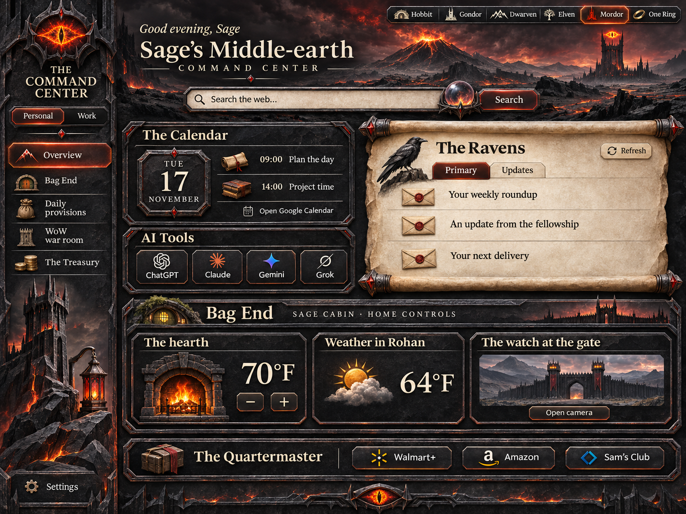
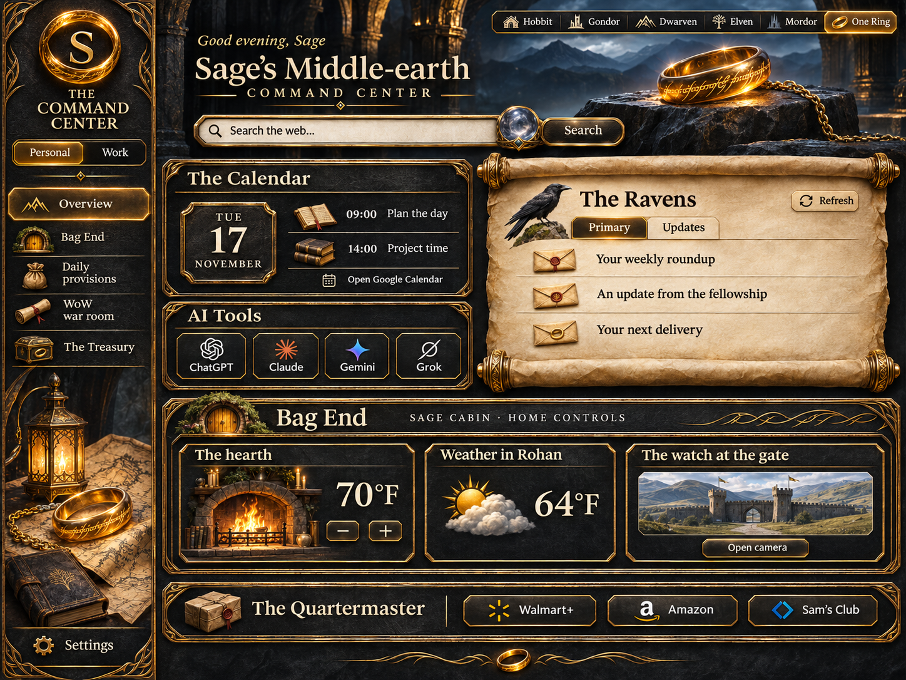

# Mordor and One Ring concepts

Saved November 17, 2026 for continuation after a context reset.

**Saved concept archive.** After this handoff, the user explicitly authorized implementation with "begin implementation" and then requested merge and deployment. The production artwork and integration are documented in [the implementation notes](../switchable-themes/DARK-REALMS.md). These PNGs remain visual references; the live interface uses individual assets and HTML controls.

## Saved artwork

- [Mordor concept](mordor-concept.png): volcanic stone, black iron, ember-red trim, Mount Doom, Barad-dur, and an Eye emblem.
- [One Ring concept](one-ring-concept.png): near-black material, polished gold, Ring-inspired engraving, an artifact-focused header, map, chain, and lantern artwork.
- [Exact generation prompts](prompts.json): generated with the built-in imagegen tool. The earlier Dwarven mockup supplied layout and quality reference; its image is preserved in `references/dwarven-layout.png`.
- [Restart notes](RESTART.md): scope and implementation cautions for a future continuation.

